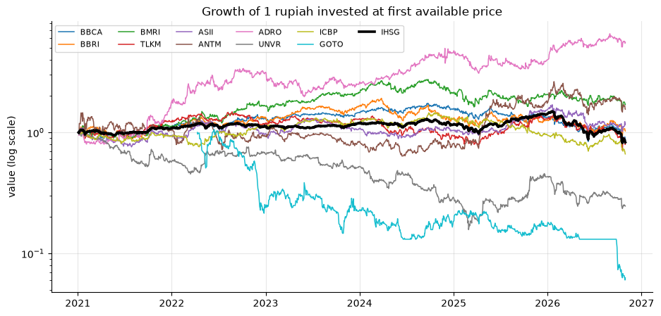
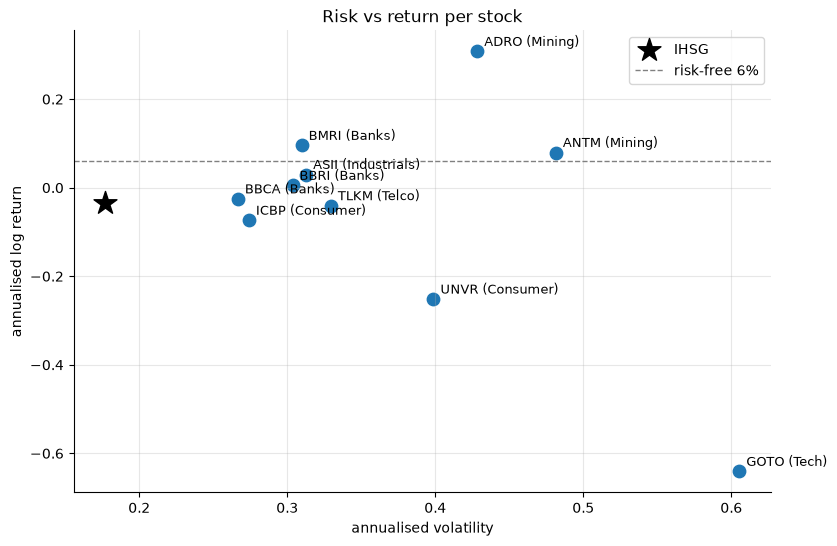
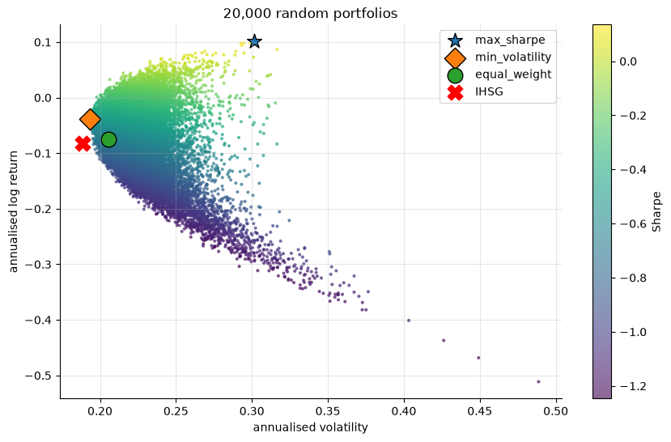
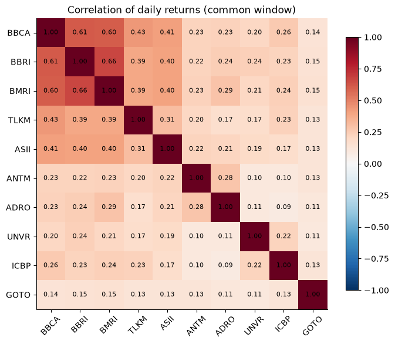
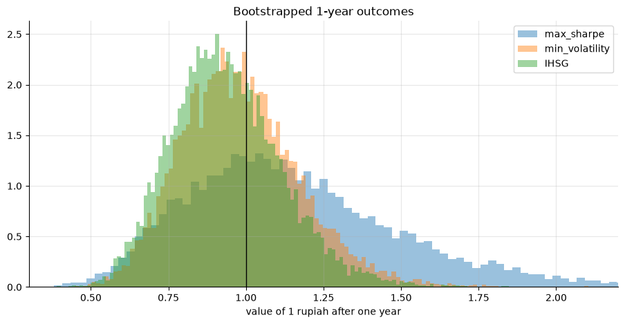

# IDX Market & Portfolio Risk Analysis

This analysis covers 10 liquid Indonesian stocks across 5 sectors, measured against the Jakarta Composite Index (IHSG),
from January 2021 to October 2026. It looks at return, risk, correlation and beta, then builds portfolios and
stress-tests them with Monte Carlo simulation.

**→ [Open the notebook](analysis.ipynb)** (it renders on GitHub with all charts and tables)



## Key findings
- **The index paid less than a deposit.** IHSG peaked around 9,130 in January 2026, then fell about 45%.
  Its annualised log return over the whole period is −3.4%, against a 6% risk-free rate.
- **Sector mattered more than "blue chip" status.**
  - The coal miner ADRO returned about 31% a year (Sharpe 0.58).
  - UNVR and GOTO lost 85% and 94% from their peaks.
  - BBCA ended slightly below zero.
- **Banks are one bet, not three.** BBRI, BMRI and BBCA correlate at 0.60–0.66, while mining and consumer pairs correlate at about 0.10.
- **The minimum-volatility portfolio** (mostly ICBP, BBCA and ASII) had the same risk as IHSG and lost less than half as much.
- **Size for a bad year.** The 5% one-year VaR is about 30–34% for every portfolio tested
  (10,000 bootstrapped years of real daily returns).

| Risk vs return | 20,000 random portfolios |
|---|---|
|  |  |
| **Correlation** | **Monte Carlo 1-year outcomes** |
|  |  |

## Methods
Log returns · annualised volatility & Sharpe ratio · maximum drawdown · beta (covariance / market variance) ·
correlation matrix · 60-day rolling volatility · random-portfolio efficient frontier (Dirichlet weights) ·
bootstrap Monte Carlo · value-at-risk & expected shortfall.

## Run it
```bash
pip install -r requirements.txt
jupyter notebook analysis.ipynb
```
Prices are downloaded from Yahoo Finance on the first run and cached in `data/`. That folder is git-ignored, and no data is shipped.

*Educational analysis, not investment advice.*
